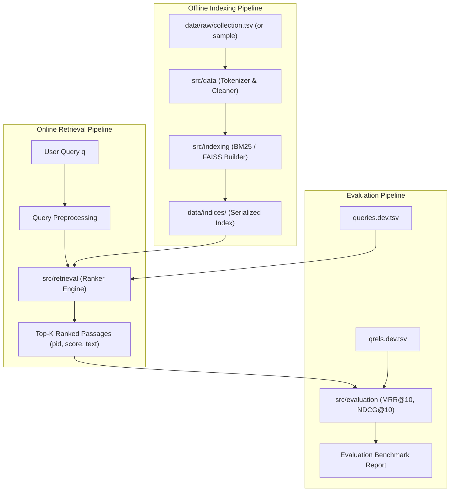

# MS MARCO Passage Retrieval System

[](https://www.python.org/)
[]()

A modular, reproducible Information Retrieval (IR) project developed for college coursework. The objective is to retrieve and rank relevant passages from the **MS MARCO Passage Ranking Dataset** for natural language search queries.

---

## 1. Project Requirements & Scope

### 1.1 The Information Retrieval Task
Given a user query $q$, the system retrieves the top-$K$ passages $\{p_1, p_2, \dots, p_K\}$ from a passage collection $\mathcal{C}$ that are most likely to answer $q$, ranked by relevance score $S(q, p)$.

### 1.2 Feature Classification

| Feature Category | Feature Description | Status / Scope |
| :--- | :--- | :--- |
| **Core (Required)** | **Modular Architecture & Config**: Central YAML config, logging, clean folder hierarchy | Completed |
| **Core (Required)** | **Data Acquisition & Streaming Validation**: TSV parsing for passages, queries, and qrels | Completed |
| **Core (Required)** | **Text Preprocessing**: Tokenization, lowercasing, non-destructive filtering | Completed |
| **Core (Required)** | **BM25 Inverted Index & Search**: Sparse inverted postings retrieval with Lucene-IDF | Completed |
| **Core (Required)** | **CLI Search Engine**: Interactive and batch search CLI (`search_cli.py`) | Completed |
| **Core (Required)** | **Evaluation Engine**: Standard MS MARCO metrics (MRR@10, nDCG@10, Recall@K) | Completed |
| *Optional Extension* | **Dense Retrieval (Sentence-BERT + FAISS)**: Semantic vector retrieval | Future Sprint |
| *Optional Extension* | **Hybrid Retrieval**: Score combination / Reciprocal Rank Fusion (RRF) | Future Sprint |
| *Optional Extension* | **Interactive Web Interface**: Streamlit-based interactive search demo | Future Sprint |

---

## 2. System Architecture & Module Responsibilities

```
ms-marco-passage-retrieval/
├── config/
│   └── default_config.yaml    # Centralized hyperparameters, filepaths, and settings
├── data/
│   ├── sample/                # 5-doc mini dataset for instant local tests & unit tests
│   ├── raw/                   # Downloaded MS MARCO TSVs (.gitignored)
│   ├── processed/             # Preprocessed tokens or cached structures (.gitignored)
│   └── indices/               # Serialized BM25 or FAISS indices (.gitignored)
├── src/
│   ├── __init__.py
│   ├── config.py              # Strongly-typed configuration loader (dataclass + PyYAML)
│   ├── data/                  # Ingestion, TSV readers, streaming generators
│   ├── indexing/              # BM25 sparse indexer & FAISS vector indexer
│   ├── retrieval/             # Query rankers (BM25 searcher, dense searcher, hybrid)
│   ├── evaluation/            # IR metrics (MRR@10, NDCG@10, MAP, Recall@K)
│   └── utils/                 # Logging, timing decorators, metric formatting
├── tests/
│   ├── __init__.py
│   └── test_smoke.py          # Environment, config, and data integrity test
├── .gitignore                 # Prevents large indices and datasets from polluting Git
├── requirements.txt           # Core lightweight dependencies (Sprint 0 & 1)
├── requirements-optional.txt  # Heavy ML dependencies for later sprints (PyTorch, FAISS)
├── run_smoke_test.py          # Standalone runner for quick sanity testing
└── README.md                  # Project documentation & sprint guide
```

### Module Responsibilities & Data Flow



---

## 3. Data Storage Strategy (Laptop-Friendly)

The full MS MARCO passage dataset contains **8.84 million passages (~3.2 GB raw)**. Indexing 8.8M passages on a laptop with 8 GB or 16 GB RAM can crash pure-Python processes.

We employ a 3-tier strategy:

1. **`sample` (Included in Git)**: 5 passages, 3 queries, 3 qrels in `data/sample/`. Allows you and your teammate to run tests in $<0.1$ second without downloading anything.
2. **`dev-subset` (Recommended for Local Dev)**: A slice of 10,000–50,000 passages and the 6,980 dev queries. Fits comfortably in ~200MB RAM and runs in seconds.
3. **`full` (Optional for Server / Final Benchmark)**: Full 8.8M passages stored in `data/raw/` (excluded by `.gitignore`).

---

## 4. Git Workflow for Two Developers

To avoid merge conflicts and work collaboratively:

```
main (always stable & tested)
 └── dev (integration branch)
      ├── feature/data-loader   (Developer A)
      └── feature/bm25-indexer  (Developer B)
```

1. **Branch Naming**:
   - `feat/feature-name` (e.g. `feat/bm25-scoring`, `feat/tsv-loader`)
   - `fix/bug-name`
2. **Pull Request Protocol**:
   - Before opening a PR, run `pytest` locally.
   - Every PR requires review and approval from the other developer.
3. **Commit Convention**:
   - `feat: add tokenization pipeline with NLTK`
   - `test: add unit test for BM25 score calculation`
   - `docs: update setup instructions in README`

---

## 5. Environment Setup Instructions

### Prerequisites
- Python 3.10, 3.11, 3.12, or 3.13 installed.
- Git installed.

### Step 1: Clone Repository & Create Virtual Environment
```bash
# In Windows PowerShell:
python -m venv venv
.\venv\Scripts\Activate.ps1

# In macOS/Linux Bash:
# python3 -m venv venv
# source venv/bin/activate
```

> **Troubleshooting Windows Execution Policy**: If PowerShell blocks activating the virtual environment, run:
> `Set-ExecutionPolicy -Scope Process -ExecutionPolicy Bypass` and then run `.\venv\Scripts\Activate.ps1`.

### Step 2: Install Core Dependencies
```bash
python -m pip install --upgrade pip
pip install -r requirements.txt
```

### Step 3: Run the Sprint 0 Smoke Test
```bash
# Option A: Using pytest
pytest -v tests/test_smoke.py

# Option B: Using the standalone runner
python run_smoke_test.py
```

---

## 6. Sprint Roadmap & Acceptance Criteria

### Sprint 0: Foundation & Environment (Current Sprint)
- [x] Standard folder structure created.
- [x] `.gitignore` configured to block large binaries and indices.
- [x] Central YAML configuration and typed Python config loader.
- [x] Logging subsystem initialized.
- [x] Sample MS MARCO format dataset (5 passages, 3 queries, 3 qrels) added.
- [x] All smoke tests pass.

### Sprint 1: BM25 Passage Retrieval & Evaluation (Next Sprint)
- TSV data parser with generator streaming for memory efficiency.
- Tokenizer pipeline (lowercasing, stopword filtering, Porter stemmer).
- BM25 indexer with serialization (`pickle` to `data/indices/`).
- Retrieval engine returning top-$K$ scored passages for any query.
- Evaluation metrics implementation: MRR@10 and NDCG@10.
- Benchmark run against sample and dev-subset datasets.

### Sprint 2: Dense Retrieval Extension (Optional)
- Sentence-Transformers embedding generator (`msmarco-distilbert-base-v4`).
- FAISS flat/IVF index construction.
- Dense vector query search.

### Sprint 3: Hybrid Retrieval (Optional)
- Reciprocal Rank Fusion (RRF) combining BM25 and Dense scores.
- Metric comparison table (BM25 vs. Dense vs. Hybrid).

### Sprint 4: Web UI Demo (Optional)
- Streamlit UI with search bar, latency display, and retrieved passage highlights.
