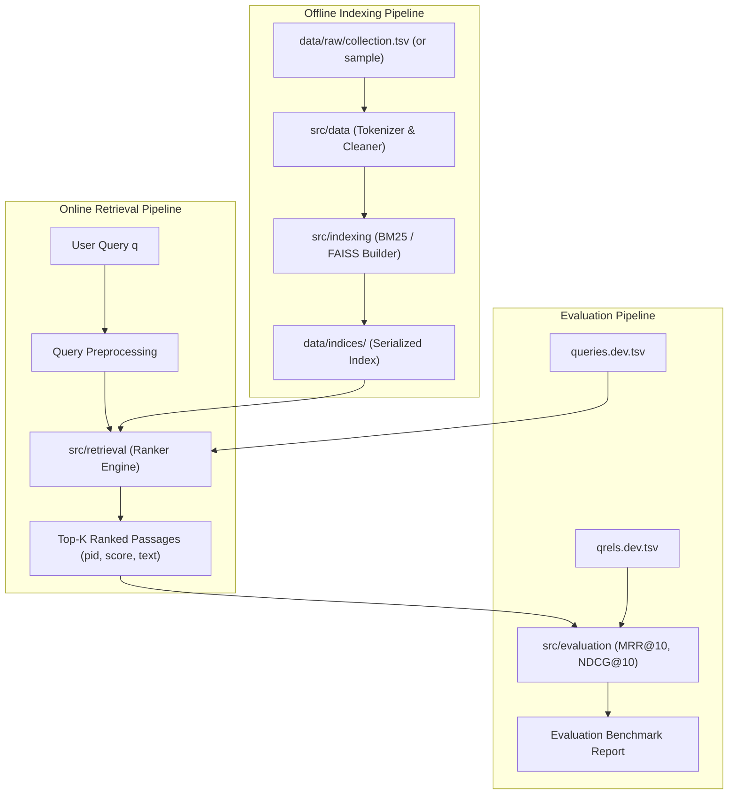

# MS MARCO Passage Retrieval System

[](https://www.python.org/)
[]()

A modular, reproducible Information Retrieval (IR) project developed for college coursework. The objective is to retrieve and rank relevant passages from the **MS MARCO Passage Ranking Dataset** for natural language search queries.

---

## 1. Project Requirements & Scope

### 1.1 The Information Retrieval Task
Given a user query $q$, the system retrieves the top-$K$ passages $\{p_1, p_2, \dots, p_K\}$ from a passage collection $\mathcal{C}$ that are most likely to answer $q$, ranked by relevance score $S(q, p)$.

### 1.2 Feature Classification

| Feature Category | Feature Description | Status / Scope |
| :--- | :--- | :--- |
| **Core (Required)** | **Modular Architecture & Config**: Central YAML config, logging, clean folder hierarchy | Completed |
| **Core (Required)** | **Data Acquisition & Streaming Validation**: TSV parsing for passages, queries, and qrels | Completed |
| **Core (Required)** | **Text Preprocessing**: Tokenization, lowercasing, non-destructive filtering | Completed |
| **Core (Required)** | **BM25 Inverted Index & Search**: Sparse inverted postings retrieval with Lucene-IDF | Completed |
| **Core (Required)** | **CLI Search Engine**: Interactive and batch search CLI (`search_cli.py`) | Completed |
| **Core (Required)** | **Evaluation Engine**: Standard MS MARCO metrics (MRR@10, nDCG@10, Recall@K) | Completed |
| **Sprint 4** | **Dense Retrieval (Sentence Transformers + FAISS)**: offline embedding pipeline, `search_dense()` | Completed |
| **Sprint 5** | **Unified Evaluation**: TF-IDF vs BM25 vs dense, Recall@5/10, MRR@10, nDCG@10, significance tests | Completed |
| **Sprint 6** | **Streamlit Interface**: search, 3-way comparison, evaluation dashboard | Completed |
| *Optional Extension* | **Hybrid Retrieval**: Score combination / Reciprocal Rank Fusion (RRF) | Future Sprint |

---

## 2. System Architecture & Module Responsibilities

```
ms-marco-passage-retrieval/
├── config/
│   └── default_config.yaml    # Centralized hyperparameters, filepaths, and settings
├── data/
│   ├── sample/                # 5-doc mini dataset for instant local tests & unit tests
│   ├── raw/                   # Downloaded MS MARCO TSVs (.gitignored)
│   ├── processed/             # Preprocessed tokens or cached structures (.gitignored)
│   └── indices/               # Serialized BM25 or FAISS indices (.gitignored)
├── src/
│   ├── __init__.py
│   ├── config.py              # Strongly-typed configuration loader (dataclass + PyYAML)
│   ├── data/                  # Ingestion, TSV readers, streaming generators
│   ├── indexing/              # BM25, TF-IDF and FAISS (dense) index builders
│   ├── retrieval/             # TF-IDF, BM25, dense searchers + registry (load any method by name)
│   ├── evaluation/            # Metrics, evaluation protocol, significance tests, reports
│   ├── utils/                 # Logging, latency summaries
│   └── ui/                    # Formatting helpers for the Streamlit app (no algorithms)
├── scripts/                   # build_sparse_indexes, build_dense_index, evaluate_all, compare_dense_bm25, ...
├── reports/eval/<mode>/       # Sprint 5 evaluation artifacts (CSV / JSON / chart / report)
├── docs/                      # VIVA_NOTES.md, UI_TEST_CHECKLIST.md
├── app.py                     # Streamlit interface (Sprint 6)
├── tests/                     # pytest suite (smoke, BM25, TF-IDF, dense, metrics, evaluation, app)
├── .gitignore                 # Prevents large indices and datasets from polluting Git
├── requirements.txt           # Core lightweight dependencies (Sprint 0 & 1)
├── requirements-optional.txt  # Heavy ML dependencies for later sprints (PyTorch, FAISS)
├── run_smoke_test.py          # Standalone runner for quick sanity testing
└── README.md                  # Project documentation & sprint guide
```

### Module Responsibilities & Data Flow



---

## 3. Data Storage Strategy (Laptop-Friendly)

The full MS MARCO passage dataset contains **8.84 million passages (~3.2 GB raw)**. Indexing 8.8M passages on a laptop with 8 GB or 16 GB RAM can crash pure-Python processes.

We employ a 3-tier strategy:

1. **`sample` (Included in Git)**: 5 passages, 3 queries, 3 qrels in `data/sample/`. Allows you and your teammate to run tests in $<0.1$ second without downloading anything.
2. **`dev-subset` (Recommended for Local Dev)**: A slice of 10,000–50,000 passages and the 6,980 dev queries. Fits comfortably in ~200MB RAM and runs in seconds.
3. **`full` (Optional for Server / Final Benchmark)**: Full 8.8M passages stored in `data/raw/` (excluded by `.gitignore`).

---

## 4. Git Workflow for Two Developers

To avoid merge conflicts and work collaboratively:

```
main (always stable & tested)
 └── dev (integration branch)
      ├── feature/data-loader   (Developer A)
      └── feature/bm25-indexer  (Developer B)
```

1. **Branch Naming**:
   - `feat/feature-name` (e.g. `feat/bm25-scoring`, `feat/tsv-loader`)
   - `fix/bug-name`
2. **Pull Request Protocol**:
   - Before opening a PR, run `pytest` locally.
   - Every PR requires review and approval from the other developer.
3. **Commit Convention**:
   - `feat: add tokenization pipeline with NLTK`
   - `test: add unit test for BM25 score calculation`
   - `docs: update setup instructions in README`

---

## 5. Environment Setup Instructions

### Prerequisites
- Python 3.10, 3.11, 3.12, or 3.13 installed.
- Git installed.

### Step 1: Clone Repository & Create Virtual Environment
```bash
# In Windows PowerShell:
python -m venv venv
.\venv\Scripts\Activate.ps1

# In macOS/Linux Bash:
# python3 -m venv venv
# source venv/bin/activate
```

> **Troubleshooting Windows Execution Policy**: If PowerShell blocks activating the virtual environment, run:
> `Set-ExecutionPolicy -Scope Process -ExecutionPolicy Bypass` and then run `.\venv\Scripts\Activate.ps1`.

### Step 2: Install Dependencies
```bash
python -m pip install --upgrade pip
pip install -r requirements.txt                 # core: BM25, TF-IDF, evaluation, tests
pip install -r requirements-optional.txt        # dense retrieval (torch, sentence-transformers, faiss) + Streamlit
```

### Step 3: Run the Sprint 0 Smoke Test
```bash
# Option A: Using pytest
pytest -v tests/test_smoke.py

# Option B: Using the standalone runner
python run_smoke_test.py
```

---

## 6. Sprint Roadmap

| Sprint | Scope | Status |
| --- | --- | --- |
| 0 | Folder structure, config, logging, toy sample, smoke tests | Done |
| 1-3 | Dataset download/validation, 100k dev subset, BM25 index + search CLI, metrics | Done |
| 4 | Dense passage retrieval (Sentence Transformers + FAISS) | Done - see section 7 |
| 5 | Evaluation of TF-IDF, BM25 and dense retrieval | Done - see section 8 |
| 6 | Streamlit user interface | Done - see section 9 |
| - | Hybrid retrieval (RRF) | Optional / future |

Concept notes for the viva (embeddings, cosine similarity, every metric worked by hand): [`docs/VIVA_NOTES.md`](docs/VIVA_NOTES.md).

---

## 7. Sprint 4 - Dense passage retrieval

### Model choice
`sentence-transformers/msmarco-MiniLM-L6-cos-v5` (set in `config/default_config.yaml -> dense.model_name`).

| Why | Detail |
| --- | --- |
| Built for this task | Bi-encoder trained on ~500k MS MARCO passage (query, answer) pairs, English |
| Small | 6-layer MiniLM, 384-dim vectors, ~90 MB download; runs on a laptop CPU |
| Normalized output | Produces unit-length vectors, so inner product = cosine similarity |
| Index size | 100,000 passages x 384 x 4 bytes = **153.6 MB** for the dev subset (exact flat index) |

Trade-off: it was trained on MS MARCO **train** queries. Evaluating on **dev** queries is legitimate (no overlap), but it is in-domain, which favours it relative to an out-of-domain test.

### Files
| File | Role |
| --- | --- |
| `src/retrieval/dense_encoder.py` | Encoder interface, Sentence Transformers wrapper, L2 normalization, model-loading errors |
| `src/indexing/dense_indexer.py` | Offline batch pipeline, resume after failure, FAISS + metadata persistence, validated loading |
| `src/retrieval/dense_searcher.py` | `DenseSearcher.search` / `search_dense(query, top_k)`, model/dimension/prefix compatibility checks |
| `src/retrieval/registry.py` | Loads TF-IDF / BM25 / dense by name (used by CLI, evaluation and the app) |
| `scripts/build_dense_index.py` | Build command |
| `scripts/compare_dense_bm25.py` | Same queries through BM25 and dense, overlap + latency report |
| `tests/test_dense_retrieval.py` | Toy end-to-end, persistence/reload, error handling, batch-failure tests |

Index directory (`data/indices/dense_dev_100k/`): `faiss.index` (vectors), `passages.jsonl` (row i -> passage ID + text), `metadata.json` (model, dimension, prefixes, counts, build stats; written last, so its presence means the build finished).

### Commands
```bash
# 1. lexical indexes (BM25 + TF-IDF) for the same corpus
python scripts/build_sparse_indexes.py --mode dev

# 2. embed every passage ONCE (first run downloads the model from huggingface.co)
python scripts/build_dense_index.py --mode dev
#    options: --batch-size 32  --device cpu|cuda  --model <name or local folder>  --no-resume

# 3. search
python search_cli.py --mode dev --method dense -q "what is the manhattan project" -k 5

# 4. compare with BM25 on identical queries (first 20 dev queries + your own)
python scripts/compare_dense_bm25.py --mode dev --num-dev-queries 20 --query "how do vaccines work"
```

Expected output of step 2 (numbers in angle brackets are measured on your machine and printed by the script):
```
================================================================
 DENSE INDEX BUILT  (mode=dev)
================================================================
 Model:              sentence-transformers/msmarco-MiniLM-L6-cos-v5
 Passages:           100,000
 Embedding dim:      384
 Encode time:        <seconds>  (<passages/s>)
 FAISS file size:    153.6 MB
 Peak process RAM:   <MB>
 Batch retries:      0
```
Encoding 100k passages on a laptop CPU should take minutes, not hours (rough estimate; the script prints the real figure and saves it to `reports/dense_index_stats_dev.json`). If it is interrupted or a batch fails, re-run the same command: it resumes from the last saved batch.

`compare_dense_bm25.py` prints load time, index size, mean/p95 latency per method, how many judged-relevant passages each found in the top-k, and the Jaccard overlap of the two result lists, and writes `reports/dense_vs_bm25_dev.md`. It makes no claim about which method is better - that is Sprint 5's job.

### Error handling
| Situation | Behaviour |
| --- | --- |
| Empty / whitespace query | returns `[]` (same as BM25) |
| `sentence-transformers` not installed, model name wrong, no internet | `DenseModelError` with fixes (install, check name, `HF_HUB_OFFLINE=1`, local folder) |
| Index folder or `metadata.json` missing / build interrupted | `DenseIndexError` naming the problem and the build command |
| FAISS dimension != metadata, vector count != passage rows | `DenseIndexError` - rebuild |
| Query model / dimension / prefix different from the index's | `DenseIndexError` - refuses to search |
| A batch fails (e.g. out of memory) | retried as two half-batches, down to single passages; a passage that still fails stops the build naming its ID; progress is kept for resume |

### Acceptance criteria
- [x] Passage embeddings computed offline once; a query encodes only the query text (`test_query_time_does_not_reencode_passages`).
- [x] FAISS row i maps to the stable MS MARCO passage ID (`test_every_passage_is_its_own_nearest_neighbour`).
- [x] Save -> reload gives identical results (`test_persistence_reload_gives_identical_results`).
- [x] Every listed failure produces a clear error (tests in `tests/test_dense_retrieval.py`).
- [x] Model name, batch size, device, prefixes and paths are configurable (YAML + CLI flags).
- [x] BM25 untouched: all Sprint 1-3 tests still pass.
- [ ] On your machine: `build_dense_index.py --mode dev` finishes and `compare_dense_bm25.py` runs (needs the dataset + model download).

---

## 8. Sprint 5 - Evaluation of TF-IDF, BM25 and dense retrieval

The repository had no TF-IDF retriever before this sprint, so one was added (`src/indexing/tfidf_indexer.py`, `src/retrieval/tfidf_searcher.py`). It uses the same tokenizer as BM25 (lowercase, no stemming, no stopword removal), so the two lexical methods differ only in weighting.

### Protocol (identical for every method)
1. **Same corpus** - all indexes must contain the same passage-ID set; a fingerprint mismatch aborts.
2. **Same queries** - the mode's query file in file order (`--max-queries N` takes the first N before exclusions).
3. **Same relevance policy** - relevant iff qrels grade >= 1; passages absent from qrels count as non-relevant; queries with no positive judgment are excluded from every method and listed in `excluded_queries.csv` with the reason.
4. **Nothing silently dropped** - judged-relevant passages missing from the corpus stay in Recall/nDCG denominators and are counted; a query whose search raises an error is scored as an empty ranking and reported.
5. **Same depth** - top 100 per query (Recall@100 + disagreement analysis).

### Command
```bash
python scripts/evaluate_all.py --mode dev                 # all three methods, all 1,000 dev-subset queries
python scripts/evaluate_all.py --mode dev --max-queries 200   # faster run
python scripts/evaluate_all.py --mode sample --methods tfidf bm25   # 5-passage smoke run, no model needed
```
Printed summary (values are whatever your run measures):
```
==============================================================================
 EVALUATION (mode=dev)  queries evaluated=<n>  excluded=<n>  corpus=100,000
==============================================================================
 Method                Recall@5   Recall@10      MRR@10     nDCG@10  Recall@100  ms/query
 TF-IDF                  ...
 BM25                    ...
 Dense (semantic)        ...
------------------------------------------------------------------------------
 MRR@10 tfidf - bm25: <diff>  (p=<p>, significant | not significant)
 ...
```

### Outputs (`reports/eval/<mode>/`)
`aggregate_metrics.json/.csv` (means + 95% bootstrap CIs), `per_query_metrics.csv`, `significance.csv` (paired randomization tests), `win_loss.csv`, `excluded_queries.csv`, `disagreements.csv`, `queries_evaluated.csv`, `runs/<method>.trec`, `comparison_table.md`, `comparison_chart.png`, `run_settings.json` (config, package versions, git commit, counts, timings), `evaluation_report.md` (results, efficiency, disagreement analysis, interpretation, caveats).

### Interpreting the scores
- MS MARCO has ~1 judged relevant passage per query. Unjudged passages can be genuinely relevant but score 0, so all metrics are lower bounds on real usefulness, and methods that find *different* good passages are penalised.
- The `dev` mode corpus (100k passages) contains **every** judged-relevant passage plus distractors from the start of the collection. Far fewer, easier distractors than the full 8.8M collection means inflated absolute scores (e.g. the earlier BM25 MRR@10 of 0.658 here is far above typical full-collection BM25 results) and possibly a different ordering of methods. Compare methods with each other on this subset; do not compare these numbers with published leaderboards.
- A difference counts only if the paired randomization test gives p < 0.05. The report says "no detectable difference" otherwise.

### Acceptance criteria
- [x] Recall@5, Recall@10, MRR@10, nDCG@10 implemented and hand-verified (`tests/test_metrics_sprint5.py`, cross-checked with `ir_measures`).
- [x] Query/passage IDs handled as strings end to end; same queries, corpus and policy for every method (`tests/test_benchmark.py`).
- [x] Exclusions and missing relevant passages reported, never hidden.
- [x] Per-query and aggregate results saved as CSV + JSON; table and chart generated from them.
- [x] Settings, counts, runtimes and latencies recorded.
- [x] Disagreement analysis with measurable hypothesis tags.
- [ ] On your machine: `python scripts/evaluate_all.py --mode dev` completes and `reports/eval/dev/` is committed.

---

## 9. Sprint 6 - Streamlit interface

`app.py` only displays things: it loads retrievers through `src/retrieval/registry.py` and metrics from `reports/eval/<mode>/`. Formatting helpers live in `src/ui/helpers.py` (unit-tested).

Features: natural-language search box; method selector; result-count slider; ranked passage cards (rank, passage ID, score bar + value, text with query words highlighted); optional dev-query picker that marks judged-relevant passages; side-by-side comparison of all three methods with overlap counts; evaluation dashboard (chart, table with CIs, significance, latency, disagreement explorer, downloads, settings, full report); clear messages for empty queries, missing indexes and model-loading failures. Indexes and the embedding model are cached with `st.cache_resource` (keyed on the index file's modification time, so a rebuilt index is picked up).

### Setup from a fresh environment
```bash
git clone https://github.com/SharadhamGupta/Passage-Retrieval-Using-MS-MARCO.git
cd Passage-Retrieval-Using-MS-MARCO
python -m venv venv
.\venv\Scripts\Activate.ps1            # Windows PowerShell  (macOS/Linux: source venv/bin/activate)
python -m pip install --upgrade pip
pip install -r requirements.txt -r requirements-optional.txt

# data: put collection.tsv, queries.dev.tsv (or queries.dev.small.tsv), qrels.dev.tsv in data/raw/
python scripts/prepare_sample.py                  # -> data/processed/ (100k passages, 1,000 queries)
python scripts/build_sparse_indexes.py --mode dev
python scripts/build_dense_index.py --mode dev
python scripts/evaluate_all.py --mode dev

streamlit run app.py                              # opens http://localhost:8501
```
Without the dataset you can still start the app on the 5-passage sample: run `python scripts/build_sparse_indexes.py --mode sample`, then `streamlit run app.py` and pick "Sample" in the sidebar.

Use another config without editing files: `MSMARCO_CONFIG=config/my.yaml streamlit run app.py` (PowerShell: `$env:MSMARCO_CONFIG="config/my.yaml"; streamlit run app.py`).

Manual UI test checklist: [`docs/UI_TEST_CHECKLIST.md`](docs/UI_TEST_CHECKLIST.md).

---

## 10. Tests

```bash
pytest -q                                  # everything (dense/UI tests skip if their packages are missing)
pytest -q tests/test_dense_retrieval.py    # Sprint 4
pytest -q tests/test_metrics_sprint5.py tests/test_benchmark.py tests/test_tfidf_retrieval.py   # Sprint 5
pytest -q tests/test_app.py                # Sprint 6 (runs app.py headless with streamlit.testing)
MSMARCO_MODEL_TESTS=1 pytest -q -k real_model   # loads the real embedding model (downloads ~90 MB once)
```
Dense pipeline tests use a deterministic hashing encoder defined in `tests/conftest.py` so they run offline in milliseconds; it is a test double only and is never used by the app or the evaluation.
