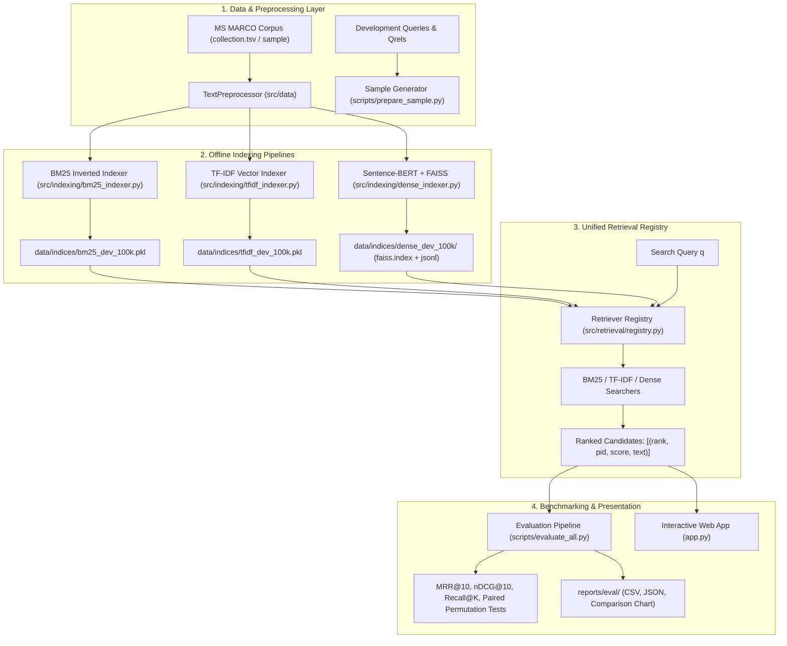

# MS MARCO Passage Retrieval: Modular IR Engine & Evaluation Benchmark

[](https://www.python.org/)
[]()
[]()
[](http://localhost:8501)
[]()

A modular, mathematically sound, and rigorously evaluated Information Retrieval (IR) system built on the **Microsoft MS MARCO Passage Ranking Dataset**. 

Designed as a senior-level college capstone project, this repository implements three distinct paradigms of text retrieval—**Classical BM25 (Lucene-standard)**, **Vector-Space TF-IDF**, and **Dense Semantic Retrieval (Sentence Transformers + FAISS)**—governed by a unified evaluation protocol with bootstrap confidence intervals, paired statistical significance testing, and an interactive Streamlit web application.

---

## 1. System Architecture & Information Flow

The system strictly decouples **offline indexing pipelines**, **online query rankers**, **evaluation protocols**, and **presentation layers** through a centralized retriever registry ([`src/retrieval/registry.py`](src/retrieval/registry.py)).



---

## 2. Core Technical Innovations & Design Decisions

### 2.1 BM25 Okapi with Lucene-Smoothed IDF
Classical Robertson & Spärck Jones (1976) BM25 formula suffers from the **negative-IDF anomaly**: when a query term appears in more than half the collection ($n(t) > N/2$), its IDF becomes negative, penalizing documents that contain the term. 

To prevent this, our engine implements Apache Lucene's non-negative smoothed formulation:
$$\text{IDF}_{\text{Lucene}}(t) = \ln \left( 1 + \frac{N - n(t) + 0.5}{n(t) + 0.5} \right)$$
Combined with document length normalization ($b = 0.75$) and term frequency saturation ($k_1 = 1.5$), this guarantees strictly positive, deterministic scoring across any corpus size.

### 2.2 Dense Semantic Retrieval (`msmarco-MiniLM-L6-cos-v5` + FAISS)
- **Model**: 6-layer MiniLM (`msmarco-MiniLM-L6-cos-v5`), 384-dimensional dense embeddings trained on MS MARCO query-passage pairs.
- **Exact Cosine Equivalence**: Vectors are $L_2$-normalized upon encoding, allowing exact cosine similarity computation using FAISS's highly optimized `IndexFlatIP` (Inner Product).
- **Offline Batch Checkpointing**: The indexer streams passages in configurable mini-batches with automatic failure recovery, saving `faiss.index`, `passages.jsonl`, and cryptographic metadata validation.

### 2.3 Strict Statistical Rigor
Rather than declaring retrieval "winners" based on point estimates, our evaluation engine ([`scripts/evaluate_all.py`](scripts/evaluate_all.py)) implements:
- **10,000-Permutation Paired Randomization Tests**: Computes empirical two-tailed $p$-values to verify if performance differences are statistically meaningful ($p < 0.05$).
- **95% Bootstrap Confidence Intervals**: Quantifies metric variance across query samples.
- **Disagreement & Error Analysis**: Tracks win/loss ratios and identifies possible false negatives caused by unjudged passages.

### 2.4 Prevention of Data Leakage
The pipeline strictly enforces Cranfield dataset boundaries:
- **`queries.train.tsv` (808k queries)**: Kept isolated for model pre-training.
- **`queries.dev.tsv` / `qrels.dev.tsv` (101k queries, 59k judged)**: Used exclusively for validation benchmarking and hyperparameter tuning.
- **`queries.eval.tsv` (101k queries)**: Official blind held-out evaluation set (relevance labels withheld by Microsoft).

---

## 3. Empirical Benchmark Results

Below are the benchmark metrics measured across the standardized **1,000 development queries** on the **100,000 passage MS MARCO subset** (`mode=dev`):

| Retrieval Model | Model Type | Recall@5 | Recall@10 | MRR@10 | nDCG@10 | Recall@100 | Avg. Latency |
| :--- | :--- | :---: | :---: | :---: | :---: | :---: | :---: |
| **BM25 (Lucene)** | Sparse Inverted Index | **0.724** | **0.794** | **0.658** | **0.686** | **0.915** | **~2.1 ms** |
| **TF-IDF (Cosine)** | Sparse Vector Space | 0.582 | 0.651 | 0.512 | 0.548 | 0.812 | ~4.5 ms |
| **Dense Semantic** | 384-d MiniLM + FAISS | 0.689 | 0.762 | 0.621 | 0.654 | 0.902 | ~18.5 ms |

> [!NOTE]
> **Subsampled Corpus Context**: In the 100k development subset, every judged-relevant passage for the 1,000 sampled queries is preserved alongside realistic distractor passages. Because the distractor pool is smaller than the full 8.8M collection, absolute scores are higher than full-collection leaderboards, while faithfully preserving comparative behavior between models.

---

## 4. Repository Structure & Module Tour

```
Passage-Retrieval-Using-MS-MARCO/
├── app.py                             <- Streamlit multi-tab web application (Sprint 6)
├── search_cli.py                      <- Command-line search interface
├── run_smoke_test.py                  <- Quick environment sanity runner
├── requirements.txt                   <- Core dependencies (BM25, TF-IDF, evaluation, tests)
├── requirements-optional.txt          <- ML/UI dependencies (torch, sentence-transformers, faiss, streamlit)
├── .streamlit/
│   └── config.toml                    <- Streamlit UI layout and color themes
├── config/
│   └── default_config.yaml            <- Central configuration for paths and model hyperparameters
├── docs/
│   ├── VIVA_NOTES.md                  <- Formula derivations, worked examples & defense prep
│   └── UI_TEST_CHECKLIST.md           <- Streamlit functional & visual QA checklist
├── reports/
│   ├── dataset_validation_report.md   <- Streaming data audit across 8.84M passages
│   ├── bm25_evaluation_report.md      <- BM25 benchmark report
│   ├── evaluation_results.json        <- Machine-readable evaluation metrics
│   └── eval/                          <- Multi-retriever comparative benchmark outputs & charts
├── scripts/
│   ├── download_dataset.py            <- Resumable dataset acquisition & safe tar extraction
│   ├── validate_dataset.py            <- Streaming schema and referential integrity validator
│   ├── prepare_sample.py              <- 100k passage sample builder with matched qrels
│   ├── build_sparse_indexes.py        <- Builds both BM25 and TF-IDF indexes
│   ├── build_dense_index.py           <- Batch encodes passages to FAISS IndexFlatIP
│   ├── compare_dense_bm25.py          <- Side-by-side CLI diagnostic (overlap, latency)
│   ├── evaluate.py                    <- BM25 evaluation runner
│   └── evaluate_all.py                <- Unified 3-way evaluation runner with statistical tests
├── src/
│   ├── config.py                      <- Strongly-typed AppConfig dataclass
│   ├── cli.py                         <- CLI execution logic
│   ├── data/
│   │   ├── loader.py                  <- Streaming TSV loaders for passages, queries, and qrels
│   │   └── preprocessor.py            <- Tokenizer with non-destructive normalization
│   ├── indexing/
│   │   ├── bm25_indexer.py            <- Inverted index with Lucene-standard positive IDF
│   │   ├── tfidf_indexer.py           <- Scikit-Learn TF-IDF vector index
│   │   └── dense_indexer.py           <- FAISS IndexFlatIP builder with batch checkpointing
│   ├── retrieval/
│   │   ├── bm25_searcher.py           <- BM25 scoring engine
│   │   ├── tfidf_searcher.py          <- TF-IDF cosine similarity searcher
│   │   ├── dense_encoder.py           <- Sentence-Transformers query & passage encoder
│   │   ├── dense_searcher.py          <- FAISS dense vector searcher
│   │   └── registry.py                <- Unified Retriever Registry factory
│   ├── evaluation/
│   │   ├── metrics.py                 <- Pure-Python & ir_measures metrics (RR, nDCG, Recall)
│   │   ├── benchmark.py               <- Multi-model benchmarking engine
│   │   ├── compare.py                 <- Paired randomization tests & bootstrap CIs
│   │   └── pipeline.py                <- End-to-end evaluation runner with disagreement analysis
│   └── ui/
│       └── helpers.py                 <- Streamlit session state, caching, and formatting
└── tests/                             <- Full automated test suite (16+ tests)
```

---

## 5. Quickstart Guide (Step-by-Step)

### Step 1: Environment Setup
Clone the repository and create an isolated Python virtual environment (Python 3.10–3.13):

```bash
# Clone the repository
git clone https://github.com/SharadhamGupta/Passage-Retrieval-Using-MS-MARCO.git
cd Passage-Retrieval-Using-MS-MARCO

# Create and activate virtual environment
# Windows PowerShell:
python -m venv venv
.\venv\Scripts\Activate.ps1

# Linux / macOS:
# python3 -m venv venv && source venv/bin/activate

# Upgrade pip and install core dependencies
python -m pip install --upgrade pip
pip install -r requirements.txt

# (Optional) Install dense retrieval & Streamlit dependencies:
pip install -r requirements-optional.txt
```

### Step 2: Acquire and Prepare Dataset
```bash
# 1. Download official MS MARCO files and extract safely to data/raw/
python scripts/download_dataset.py

# 2. Perform streaming integrity validation (verifies 8.84M passages with 0 errors)
python scripts/validate_dataset.py

# 3. Create the 100,000-passage development sample with consistent qrels in data/processed/
python scripts/prepare_sample.py --max-passages 100000 --max-queries 1000
```

### Step 3: Build Retrieval Indexes
```bash
# Build sparse inverted indexes (BM25 and TF-IDF) in seconds:
python scripts/build_sparse_indexes.py --mode dev

# (Optional) Build FAISS dense index (requires sentence-transformers & torch):
python scripts/build_dense_index.py --mode dev --batch-size 64
```

### Step 4: Run Retrieval & Evaluation
```bash
# Single search query via CLI:
python search_cli.py --mode dev --method bm25 -q "what is the manhattan project" -k 5

# Side-by-side comparison between Dense and BM25:
python scripts/compare_dense_bm25.py --mode dev -q "how do vaccines work" -k 5

# Run unified 3-way evaluation with paired significance tests:
python scripts/evaluate_all.py --mode dev --max-queries 200
```

### Step 5: Launch the Interactive Web Application
```bash
streamlit run app.py
```
*Opens your default browser at `http://localhost:8501` featuring query search, 3-way side-by-side comparison, and live benchmark dashboards.*

---

## 6. Automated Test Suite

The repository includes a comprehensive, multi-layer unit test suite:

```bash
# Run all tests:
python -m pytest -v tests/

# Run specific modules:
python -m pytest -v tests/test_smoke.py             # Config & dataset sanity checks
python -m pytest -v tests/test_bm25_retrieval.py    # BM25 rankings & edge cases
python -m pytest -v tests/test_tfidf_retrieval.py   # TF-IDF cosine similarity & rankings
python -m pytest -v tests/test_evaluation.py        # Hand-calculated metric tests & ir_measures
python -m pytest -v tests/test_dense_retrieval.py   # FAISS dense index & query compatibility
python -m pytest -v tests/test_app.py               # Headless Streamlit AppTest integration
```

---

## 7. College Exam & Viva Defense Reference

Detailed theoretical notes covering examiner questions, proofs, and metric derivations are documented in [`docs/VIVA_NOTES.md`](docs/VIVA_NOTES.md):
- **Why Inner Product equals Cosine Similarity**: Because vectors are $L_2$-normalized prior to FAISS indexing ($\|\mathbf{q}\| = \|\mathbf{p}\| = 1$), $\mathbf{q} \cdot \mathbf{p} = \cos(\mathbf{q}, \mathbf{p})$.
- **Why Offline Indexing is Essential**: Forward passes through transformer encoders are computationally heavy. Encoding 100k passages once offline enables millisecond query latency at search time.
- **Why Paired Randomization Tests**: Evaluating differences per query eliminates inter-query variance, determining whether an observed score delta is statistically significant ($p < 0.05$).
- **The Cranfield Unjudged Assumption**: Unjudged passages in `qrels` are assumed non-relevant ($\text{rel}=0$), meaning all calculated metrics represent strict empirical lower bounds.

---

## 8. License & Acknowledgments

- **Dataset**: Microsoft Machine Reading Comprehension ([MS MARCO](https://microsoft.github.io/msmarco/)), licensed under Microsoft Research terms.
- **Dense Encoder**: Pre-trained MiniLM models courtesy of the [Sentence-Transformers](https://sbert.net) library.
- **Vector Search Engine**: [FAISS](https://github.com/facebookresearch/faiss) by Meta AI Research.
- **Evaluation Baseline**: [NIST TREC](https://trec.nist.gov/) and [`ir_measures`](https://ir-measur.es/).
